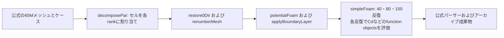
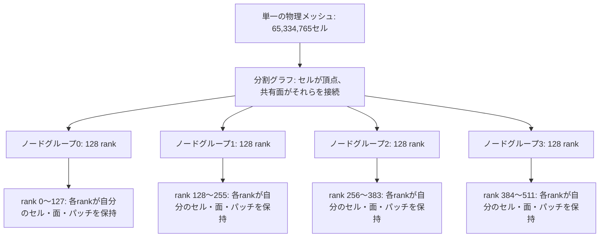
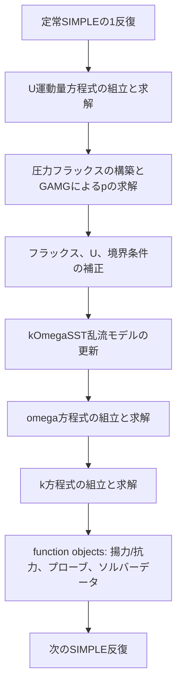
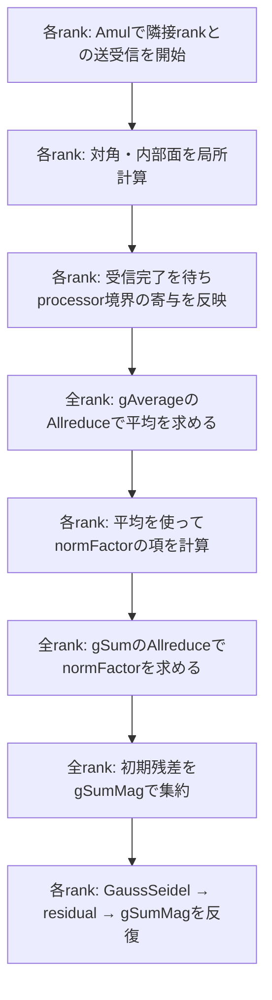
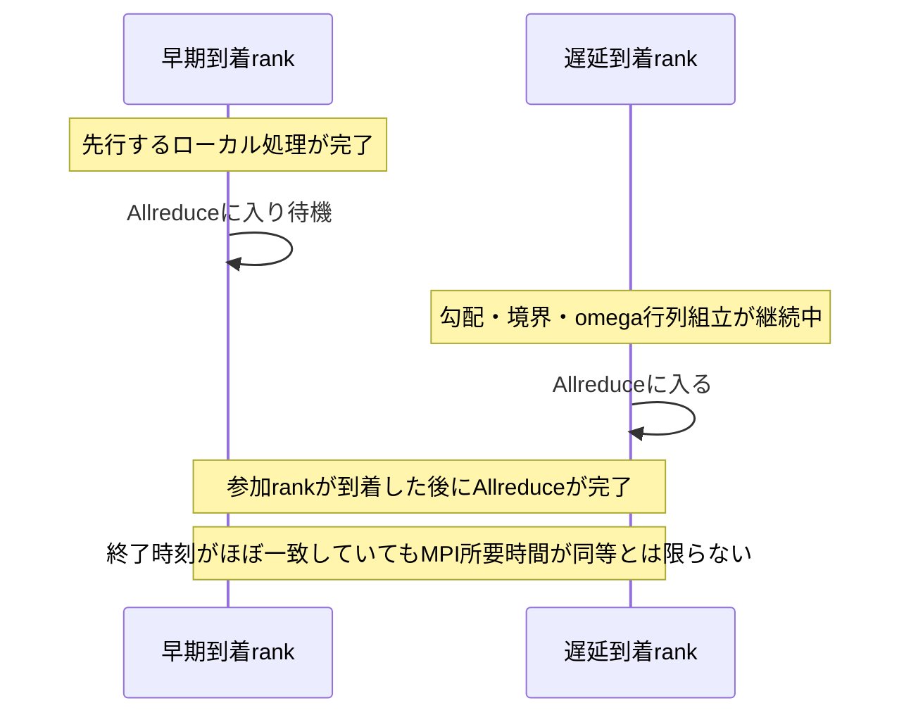

# OpenFOAM HPCタスク: 計算・通信・同期

本ドキュメントは、指定された`occDrivAerStaticMesh-65M`タスクについて、領域分割から1反復内の計算・通信までを説明する。根拠はOpenFOAM.com v2512のコード、公式ケース、Issue #33のASPIRE-2A 4ノード計測である。図は処理の関係を示し、実測値は採取条件とともに記す。

## 1. タスクの境界と性能指標

固定ワークロードは、定常非圧縮ソルバー`simpleFoam`、`kOmegaSST`乱流モデル、IEEE倍精度を用いた65,334,765セルのDrivAerメッシュである。必須の実行順序は、`decomposePar -constant` → `restore0Dir -processor` → `renumberMesh -constant -overwrite -parallel` → `potentialFoam -initialiseUBCs -parallel` → `applyBoundaryLayer -ybl 0.0450244 -parallel` → `simpleFoam -parallel`。1・2・4ノードではそれぞれ40・80・150回のSIMPLE反復を実行する。評価指標は2反復目以降の`Average wall-clock time per time step`であり、最終抗力係数`Cd`は`coefficient.dat`から取得する。これらの条件とBasic/Bonusの区分は[公式ルール](../tasks/2.%20OpenFOAM%20HPC%20Task%20Rules.md)、入力の識別情報とセル数は[`benchmark/workload.json`](../benchmark/workload.json)に記録されている。

Actions全体では、ビルド選択、資源確保、ケース準備、solver、成果物回収にそれぞれ時間がかかる。公式の性能指標はsolverの反復時間で、キュー待ちや領域分割時間は含まない。各反復では`forceCoeffsAll`などのfunction objectsも動く。`controlDict.noWrite`は通常の反復で全フィールドの出力を避ける設定だが、これらの評価処理は実行する。[`controlDict.noWrite`](../benchmark/occDrivAerStaticMesh/system/controlDict.noWrite)、[`forceCoeffsAll`](../benchmark/occDrivAerStaticMesh/system/forceCoeffsAll)を参照。

## 2. 領域分割が変更するもの

領域分割は、既存の各セルを一つのMPI rankへ割り当てる操作で、セルの大きさや個数は変えない。面の両側のセルを同じrankが担当すれば、その面はrank内で処理する。担当rankが異なれば、対応するprocessor patchが作られ、両rankは境界に接するセルの値を交換する。車輪・車体下面などの物理境界はprocessor patchとは別で、境界条件の計算を生む。`renumberMesh`は分割後のセルと面の番号を付け直してアクセス順序を変える。

配布ケースの初期設定は`hierarchical (16 8 4)`。Issue #33で比較した設定は、各階層でScotchを使う`multiLevel (4 2 4 16)`であり、4 × 2 × 4 × 16 = 512領域を作る。ASPIRE-2Aの4ノード実行では各ノードに128 rankを配置した。全体を均等に分けた場合、1 rank当たり約127,607セルとなる。最初の4分割をノードに対応させ、各ノード内でさらに分ける構成である。[`prepare-openfoam-case.sh`](../scripts/prepare-openfoam-case.sh)、[Issue #33の分割監査](https://github.com/2026-APAC-HPC-AI-Tokyo-Rapids/1_OpenFOAM/issues/33#issuecomment-5838070249)を参照。2026-09-25の規則追補では`multiLevel`はBonus、未改変v2512の`hierarchical`と`scotch`はBasicに該当する。

任意の`weightField`は、**分割器に渡すセルの見積もりコスト**を変更する。ソルバー内の方程式やセル数は変更しない。`multiLevel`の4階層は、同じ重み配列から対象領域のセルだけを抜き出して次の階層へ渡す。重み3が3³や3⁴へ増える処理はない。[multiLevelDecomp.C](https://github.com/2026-APAC-HPC-AI-Tokyo-Rapids/3_OpenFOAM_Src/blob/5a55da3fb12800863bf76122c50bb0850222cab0/src/parallel/decompose/decompositionMethods/multiLevelDecomp/multiLevelDecomp.C#L320-L451)を参照。現行のScotch向けコードは相対重みを整数の`SCOTCH_Num`へ変換するため、単純な二値の1.2:1は実質1:1となる。これは分割器の入力表現による制約で、Allreduceの頻度とは関係しない。[scotchDecomp.C](https://github.com/2026-APAC-HPC-AI-Tokyo-Rapids/3_OpenFOAM_Src/blob/5a55da3fb12800863bf76122c50bb0850222cab0/src/parallel/decompose/scotchDecomp/scotchDecomp.C#L209-L267)を参照。

## 3. 1つのrankが1回のSIMPLEステップで計算する内容

有限体積法は、面を通る流束と勾配から、セル中心の値を未知数とする疎な連立方程式を組み立てる。各rankは担当領域の`U`、`p`、`k`、`omega`、流束、係数、行列の参照先を保持する。疎行列`lduMatrix`にはローカルセルの対角係数と、rank内の内部面に対応する上三角・下三角係数があり、rankをまたぐ寄与はprocessor interfaceを介して処理する。4ノードの例では1 rankが平均約12万8000セルと数十万の内部面をループ処理する。

v2512の[`simpleFoam.C`](https://github.com/2026-APAC-HPC-AI-Tokyo-Rapids/3_OpenFOAM_Src/blob/5a55da3fb12800863bf76122c50bb0850222cab0/applications/solvers/incompressible/simpleFoam/simpleFoam.C#L75-L124)は、外側のSIMPLEループ1回につき、運動量方程式（`UEqn.H`）、圧力補正（`pEqn.H`）、そして`turbulence->correct()`を順に実行する。同梱の[`fvSolution.fixedIter`](../benchmark/occDrivAerStaticMesh/system/fvSolution.fixedIter)では、`U`に対して`smoothSolver`/GaussSeidelおよび最大15反復、`k`と`omega`に対して同種ソルバーおよび最大8反復、`p`に対してGAMG/GaussSeidel、最大12反復、最粗レベルでPCG/DICが設定されている。`nNonOrthogonalCorrectors 0`は、外側ステップ1回あたり圧力補正パスが1回であることを意味する。これらは提供されたケースのアルゴリズム設定であり、反復上限値を外側のSIMPLEステップ数と混同してはならない。圧力のGAMG階層は、さらに粗いレベルでの計算と通信を実行する。

領域分割の`multiLevel`と、圧力ソルバー`GAMG`の多重格子階層は別の処理である。前者はsolver起動前にセルの担当rankを決め、後者は各SIMPLE反復内の圧力方程式を複数の格子レベルで解く。

最初の`omega`解法より前に、遅いrankと速いrankの時間差が広がる。Issue #33の診断では、速度勾配、壁面・連結境界、混合関数`F1/F23`、特に`omega`行列の組立で差が増えた。Stage 8で選んだ高速50 rankと低速50 rankの中央値を比べると、`omega`解法前の所要時間差は**52.578 ms**。低速群の記録済みWaitall時間は**63.797 ms短く**、Waitall/Allreduceを除いた時間は**120.244 ms長い**。これらは計装した10反復におけるrank群の比較値である。[Stage 9解析](https://github.com/2026-APAC-HPC-AI-Tokyo-Rapids/1_OpenFOAM/issues/33#issuecomment-5828489364)を参照。

## 4. 高負荷なローカルループが発生する箇所

| コード領域 | ローカル処理 | 通信および同期 | 観測されたコストと解釈 |
| --- | --- | --- | --- |
| `GaussSeidelSmoother::smooth` | 右辺ベクトルを再利用可能な作業配列へコピーする。各セルで面番号を介して隣接値を読み、対角成分で割り、計算結果を後続セルへ反映する。更新値を次のセルが使うため処理順序に依存する。 | 各スイープでprocessor interfaceの値を交換し、受信完了後にセルループへ進む。Allreduceはセルループ内で呼ばない。 | 旧`(4 128)`分割のuProfでは、サンプリングサイクル比率14.62%、IPC 0.885、分岐ミス率6.08%。**CPUサイクル比でありソルバーの経過時間比ではない**。 |
| `lduMatrix::Amul` | 対角成分の積と、両側の面の`Aψ`への寄与を計算する。観測された非CSRパスでは、面ループがインデックス付きの読み込みおよび更新を行う。 | 隣接rankとの交換を開始し、ローカルの対角/面項を計算した後、interface更新を完了する。一部の通信はローカル処理とオーバーラップ可能である。 | uProfサンプリングサイクル比率5.92%、IPC 0.596。現行の`(4 2 4 16)`計装実行において、rankあたり/ステップあたりの`Amul`累積時間の中央値は249.077 ms（面ループ149.707 ms、interface更新42.000 ms）であった。これらの測定時間には複数回の呼び出しが含まれる。 |
| `lduMatrix::residual` | `r = b − diag·ψ` で初期化し、各内部面について両側のセルを更新する。 | 隣接rankとの交換を開始し、ローカルループの後にその寄与を適用する。その後、ソルバーは全rankの残差の大きさを集約する。 | uProfサンプリングサイクル比率10.96%、IPC 0.476。現行分割の計装では`smoothSolver.residual`呼び出し区間の合計がrank・ステップ当たり中央値410.421 ms。ラッパー処理を含むため、**residual関数単体の自己時間ではない**。 |
| `omega`行列の組立 | 勾配、混合関数、面係数、一時配列、行列の下三角・上三角係数を計算する。 | 連結境界で隣接rankと交換する。ここで生じた到着時刻差は、後続のAllreduceに現れる。 | Stage 11の`omegaDiv.internalFaces`における遅い群と速い群の時間差は16.626 ms。差は一つのコピーではなく5つの配列操作に分散していた。 |

出典: [GaussSeidelSmoother.C](https://github.com/2026-APAC-HPC-AI-Tokyo-Rapids/3_OpenFOAM_Src/blob/5a55da3fb12800863bf76122c50bb0850222cab0/src/OpenFOAM/matrices/lduMatrix/smoothers/GaussSeidel/GaussSeidelSmoother.C#L117-L174)、[lduMatrixATmul.C](https://github.com/2026-APAC-HPC-AI-Tokyo-Rapids/3_OpenFOAM_Src/blob/5a55da3fb12800863bf76122c50bb0850222cab0/src/OpenFOAM/matrices/lduMatrix/lduMatrix/lduMatrixATmul.C#L37-L340)、[uProf再解析](2026-09-23-aspire2a-uprof-reanalysis.md)、[現行分割のフェーズ別タイミング](https://github.com/2026-APAC-HPC-AI-Tokyo-Rapids/1_OpenFOAM/issues/33#issuecomment-5833720514)、および[Stage 11](https://github.com/2026-APAC-HPC-AI-Tokyo-Rapids/1_OpenFOAM/issues/33#issuecomment-5833053118)。

uProfで採取したL1需要補充では、GaussSeidelの95.04%がローカルL2由来で、`residual`の13.46%と`Amul`の14.32%がローカルDRAM/IO由来だった。これは**採取したL1需要補充の内訳**であり、全メモリアクセスの割合やDRAM帯域ではない。現行分割のStage 8では、rank 287と349の内部面数がほぼ同じ（380,575対380,801面）にもかかわらず、`omega`内部面係数ループは20.688対1.318 ms、ローカルDRAM/IO由来の需要補充は190,645対8,209回だった。このペアの時間差にはメモリアクセスが強く関係している。計測の単位はrank内の処理区間なので、どのセルが遅いかまでは特定していない。[Stage 8](https://github.com/2026-APAC-HPC-AI-Tokyo-Rapids/1_OpenFOAM/issues/33#issuecomment-5824103802)を参照。

## 5. 2種類の異なるMPI通信

| 種類 | 参加者およびペイロード | 代表的な呼び出し箇所 | 待機メカニズム |
| --- | --- | --- | --- |
| processor interfaceでの交換 | 境界を共有するrank同士。切断面の値を配列にまとめて送る。 | `Amul`、`residual`、GaussSeidel、勾配・境界処理。 | 非同期送受信を開始し、隣接rankの値を使う地点で受信完了を待つ。`MPI_Waitall`などに隣接rankの遅れが現れる。 |
| Allreduce | 同じMPI communicatorに参加する全rank。セルの配列全体ではなく、局所的に求めた和・個数・ノルムなどを集約する。 | `normFactor`、残差ノルム、連続性誤差、GAMG/PCG、一部のfunction objects。 | 全rankが結果を使うため、早く到着したrankは遅いrankを待つ。 |

processor interfaceの実装は、境界に接するローカルセルの値を配列へ詰め、隣接rankとの非同期送受信を開始する。受信値が必要になったら完了を待ち、ローカルの結果へ反映する。[lduCalculatedProcessorField.C](https://github.com/2026-APAC-HPC-AI-Tokyo-Rapids/3_OpenFOAM_Src/blob/5a55da3fb12800863bf76122c50bb0850222cab0/src/OpenFOAM/matrices/lduMatrix/lduAddressing/lduInterface/lduCalculatedProcessorField/lduCalculatedProcessorField.C#L101-L195)を参照。`Amul`では送受信の開始と完了の間にローカルの対角・面ループがあり、通信と計算が重なり得る。GaussSeidelでは受信完了後にセル更新ループを実行する。同じ交換でも待機が現れる位置は異なる。ノード内の交換とノード間の交換は同じprocessor interfaceを通るが、後者はネットワークを経由する。`(4 2 4 16)`分割の最初の4領域は、ノード間の切断面を抑える狙いがある。

`smoothSolver`は平滑化ループの前に`Amul` → `normFactor` → 初期残差ノルムを計算する。`normFactor`は局所的な`sumA`の後、`gAverage(psi)`で「値の和とセル数」を**1回のAllreduce**にまとめて集約する。得られた全体平均を使って各セルの項を作り、`gSum(...)`でもう**1回のAllreduce**を行う。後者の入力は前者の結果に依存するため、2回をそのまま1回へまとめることはできない。その後、各平滑化反復でGaussSeidel、`residual`、残差を集約する`gSumMag(residual)`を呼ぶ。[smoothSolver.C](https://github.com/2026-APAC-HPC-AI-Tokyo-Rapids/3_OpenFOAM_Src/blob/5a55da3fb12800863bf76122c50bb0850222cab0/src/OpenFOAM/matrices/lduMatrix/solvers/smoothSolver/smoothSolver.C#L127-L205)、[lduMatrixSolver.C](https://github.com/2026-APAC-HPC-AI-Tokyo-Rapids/3_OpenFOAM_Src/blob/5a55da3fb12800863bf76122c50bb0850222cab0/src/OpenFOAM/matrices/lduMatrix/lduMatrix/lduMatrixSolver.C#L235-L274)、[FieldFunctions.C](https://github.com/2026-APAC-HPC-AI-Tokyo-Rapids/3_OpenFOAM_Src/blob/5a55da3fb12800863bf76122c50bb0850222cab0/src/OpenFOAM/fields/Fields/Field/FieldFunctions.C#L646-L670)を参照。

40反復の`(4 2 4 16)` PMPI診断では、**rank当たり**63,194回の`MPI_Allreduce`を記録した。連続する`omega`の`normFactor`呼び出し間には、Allreduceの呼び出し番号で約1,545件の隔たりがある。この間には圧力・速度・乱流などの多くの処理が入る。計装した診断実行の回数であり、公式スコアの計測値ではない。[PMPI再解析](2026-09-23-aspire2a-pmpi-prewait-reanalysis.md)、[Issue #33のソース解析](https://github.com/2026-APAC-HPC-AI-Tokyo-Rapids/1_OpenFOAM/issues/33#issuecomment-5796228680)を参照。

## 6. Allreduceが見かけ上高コストに見える理由

AllreduceのMPI内所要時間には、**到着時刻差による待機**、実際の通信・集約、MPI実装の処理が含まれる。例えば遅いrankが隣接rankを`MPI_Waitall`で待ってからAllreduceへ進む間、早いrankはAllreduceの内部で待つ。同じ待機が別のMPI関数に見える場合もある。512 rankのMPI内時間を合計した「rank秒」は、ソルバー全体からそのまま削れる秒数ではない。

旧`(4 128)`分割を用いた別の150反復CrayPAT実行では、各rankのプロセス経過時間は767.14〜768.57秒とほぼ揃う一方、rankごとの`MPI_Waitall`累積時間は32.99〜467.46秒、`MPI_Allreduce`は28.93〜352.53秒だった。二つのMPI関数の累積時間には負の相関（`r = -0.678`）があり、待機がどちらの関数に現れるかはrankで大きく異なる。この実行で記録された有向のrank間送信は合計2.8515 TBで、そのうちノード間は203.9 GB（7.15%）だった。これは通信量の実測であり、通信のみがsolver時間を占めた割合ではない。CrayPATを有効にした実行は通常実行より遅いため、時間値を公式の2.87秒/反復と直接比較しない。[CrayPAT再解析](https://github.com/2026-APAC-HPC-AI-Tokyo-Rapids/1_OpenFOAM/issues/33#issuecomment-5787963644)を参照。

現行分割の10反復診断では、最初の`omega` `normFactor.gAverage`に到着する時刻の差は、各ノード内で約28〜47 msだった。この差は、最初の`omega` `Amul`に入る前の乱流モデル準備中に拡大していた。36組の早着rank・遅着rankを比べると、遅着側の到着前の累積時間は、`Amul`で中央値**16.531 ms短く**、`smoothSolver.smooth`でも**4.463 ms短かった**。したがって、これらの行列演算は処理量の大きい改善対象だが、この`omega` Allreduceへの到着差は、その前の勾配、境界操作、混合関数、行列組立で生じた。[フェーズ別時刻](2026-09-24-aspire2a-issue33-phase-timing.md)、[3関数と到着時刻の比較](https://github.com/2026-APAC-HPC-AI-Tokyo-Rapids/1_OpenFOAM/issues/33#issuecomment-5833775433)を参照。

時刻差の数値は**各ノード内の128 rank**を比較したものだ。ノード間の時計を校正していないため、全512 rankの絶対的な到着順序は示さない。上流処理を改善した場合の効果は、計装なしの公式実行で1反復の時間として測る。`gAverage`は値の和と個数を既に1回のAllreduceにまとめているため、個数用の通信だけを取り除く余地はない。

## 7. 3:1の重み付け領域分割から得られた知見

Issue #33では、15個の車輪・車体下面パッチに接する既存の3,454,957セル（全体の5.288%）へ重み3、残りへ重み1を設定した。メッシュ形状とセル数は変えていない。4ノード・512 rankの分割で、rank当たりセル数の標準偏差は1,079.64から13,443.47へ増え、ノード間の切断面は9.332%減った。公式150反復の重みなし結果は3回平均2.866837秒/反復、重み3:1の2回は3.176969秒と4.704889秒/反復だった。Cdも重みなしの0.2913877775から0.2838249395へ**2.595%低下**し、Bonus F3の許容幅±0.5%を超えた。したがって、この3:1設定は性能とCdの両面で採用できない。2回の速度差が大きいため、遅さの何割がセル数の偏りによるかはrank別の時間計測が必要である。[重み付け実験](https://github.com/2026-APAC-HPC-AI-Tokyo-Rapids/1_OpenFOAM/issues/33#issuecomment-5838070249)、[ルール追補の適用](https://github.com/2026-APAC-HPC-AI-Tokyo-Rapids/1_OpenFOAM/issues/33#issuecomment-5842552735)を参照。

この実験から、**分割に与える重みは実測した処理時間を基に決める必要がある**と分かる。車輪周辺を担当するrankが遅いという観測だけでは、各表面セルの計算コストが3倍とは決められない。Stage 8では、内部面数がほぼ同じrankの間でもDRAM由来の需要補充と所要時間に大きな差があった。セル数、内部面数、物理境界、processor interface、メモリ局所性、rank配置を合わせて調べてから重みを決める。

## 8. 測定値をどの判断に使うか

| 根拠 | 読み取れること | 測定条件と用途 |
| --- | --- | --- |
| v2512ソースコード | ループ順序、依存関係、隣接通信とAllreduceの呼び出し位置。 | 特定の実行時間を知るには時刻計測と組み合わせる。 |
| uProfの32 rankサンプリング | 3関数の推定CPUサイクル比、IPC、分岐ミス率、L1需要補充元。 | 旧`(4 128)`分割のCPU内特性を示す。 |
| PMPIとソース内フェーズ記録 | rank別MPI時間、ノード内の処理区間とAllreduce到着時刻。 | 現行`(4 2 4 16)`分割の計装した診断実行を対象とする。 |
| 公式150反復の複数実行 | 秒/反復、Cd、実行間のばらつき。 | 計装なしの採用判断に使う。 |

改善対象は二つある。**繰り返す局所計算**では、`GaussSeidel`、`residual`、`Amul`、`omega`行列組立のメモリ読み書きと待機を減らす。**rank間の同期**では、最初の`omega`解法より前に生じる到着時刻差を縮める。2026-09-25の追補により、数値計算の内容を保つソース変更はBonusとして検討できる。採用には、変更前の同条件ベースラインと、1・2・4ノードの最終Cdがそれぞれ±0.5%以内に収まることを示す必要がある。改善率は計装なしの公式ベンチマークで判断する。[公式ルールのF2・F3](../tasks/2.%20OpenFOAM%20HPC%20Task%20Rules.md#f2-bonus-experimental-work)を参照。
